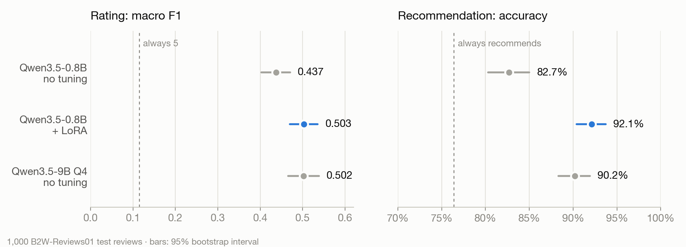
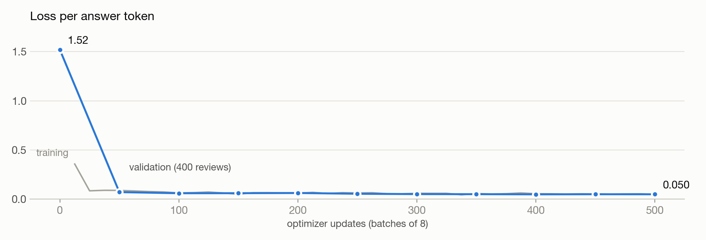

# I fine-tuned a 0.8B model and it tied with a 9B one. Here is how I measured it

*LoRA fine-tuning on a Mac, on Brazilian Portuguese customer reviews, and the three things that nearly spoiled the result.*

Small models are cheap to run, but they usually lose to big ones. I wanted to answer a concrete question: if I fine-tune a 0.8-billion-parameter model for a single task, does it catch up with an untuned model 11 times its size?

The task: read a customer review in Portuguese and return a JSON object with the rating the customer gave the product (1 to 5) and whether they would recommend it to a friend.

```text
Título: Não recomendo
Avaliação: Chegou com a tela trincada e o suporte não responde.
→ {"nota": 1, "recomenda": false}
```

(*"Not recommended. It arrived with a cracked screen and support doesn't answer."* `nota` is the rating, `recomenda` the recommendation.)

This is the kind of job a company with millions of reviews wants to run at scale and on a small budget. I compared three models with the same prompt: Qwen3.5-0.8B without tuning, the same model with a 14 MB LoRA adapter, and Qwen3.5-9B quantized to 4 bits, without tuning.

Short answer: on the rating, the tuned 0.8B tied with the 9B. On the recommendation, it beat it. And on the same Mac it answers almost four times faster.



The long answer is more interesting, because the way there had a measurement trap, a training run that did not fit in memory and a wrong license.

## The data: split by product, not by review

I used B2W-Reviews01: 132 thousand real reviews from Americanas, a large Brazilian online store, collected in 2018. Each one has a star rating and an answer to "would you recommend this product to a friend?". I dropped reviews without text (3,275), without a recommendation answer (18) and repeated texts (2,384).

The decision that weighs most on the result is how to separate training from test data. The obvious way is to shuffle reviews. The problem is that a product has dozens of similar reviews: if some go to training and others to test, the model is tested on products it has already seen, and the score comes out optimistic. So I split by a hash of `product_id`, and each product lands in a single split. Repeated texts were removed before the split for the same reason: "Excellent product, I recommend it" shows up under many different products.

From each split I took a random sample, unbalanced: 4,000 training reviews, 400 validation and 1,000 test. The test set keeps the real rating distribution, with 40% five-star reviews and only 6% two-star ones.

## Measure before training

Accuracy is misleading on this task. A "model" that always answers 5 gets 40% of the ratings right and looks reasonable. The main metric was **macro F1**, the mean of the F1 for each of the five ratings, which gives rare ratings the same weight. Always answering 5 scores 0.115 on it.

I also kept format apart from content. Broken JSON counts as an invalid format, but the values are still read with a regular expression. That way "got the format wrong" and "got the rating wrong" show up as separate problems.

And I computed confidence intervals. With 1,000 examples and only 62 two-star reviews, macro F1 moves by a few hundredths from one sample to the next. The bootstrap, with 1,000 resamples of the test set, gives each model's interval. To compare two models, though, two overlapping intervals tell you nothing. What counts is the **paired bootstrap**: resample the same examples for both models and look at the interval of the difference, which removes the variation that comes from examples that are hard for everyone.

That mattered on the very first comparison. The intervals of the base and tuned models touch at 0.470, which looks like a tie. The paired difference, +0.066 (interval +0.024 to +0.109), shows the gain is real.

The baseline could already do the task: the untuned 0.8B scores 0.437 macro F1. But it guesses 5 too often (170 of the 224 four-star reviews became 5) and breaks the format in 35 answers, with `"nota": 0`, `"recomenda": "true"` as a string, or `"nota": 10`.

## The training run that did not fit in memory

The first attempt was the standard one: rank-16 LoRA on all 24 layers, batches of 8, with [mlx-lm](https://github.com/ml-explore/mlx-lm) on a Mac with an M5 and 24 GB. It ran out of GPU memory on the first step. With batches of 4 and gradient checkpointing it ran, but at 0.13 batches per second with a 12 GB peak. That made no sense for a 0.8B model, and the two epochs I had planned would have taken more than 4 hours.

The clue was in the architecture. Qwen3.5 is a hybrid: 18 of its 24 layers use linear attention (Gated DeltaNet), a recurrence that updates a state at every token, instead of full attention. Reading the model code in mlx-lm, I found this line:

```python
use_kernel=not self.training
```

Outside training, the recurrence runs in a hand-written Metal kernel. In training, since the kernel has no gradient, mlx-lm falls back to the reference implementation: a Python loop that processes one token at a time. For the backward pass, the framework keeps the state from every step, a 16 × 128 × 128 float32 matrix, or 1 MB per token, per sequence, per layer. By that math, a batch of 4 reviews of about 150 tokens adds up to nearly 11 GB of states across the 18 layers.

The way out came from a simple observation: the gradient only has to flow through the layers that carry LoRA. The layers below them have nothing trainable and only receive the embeddings, which are frozen. So I put LoRA only on the top 8 layers and pinned the bottom 16 in evaluation mode, where they use the fast kernel. In the repository the function is in Portuguese; `congelar_em_avaliacao` means "freeze in evaluation mode":

```python
def congelar_em_avaliacao(camadas):
    def fixar(_, modulo):
        modulo._training = False
        modulo._set_training_mode = lambda modo: None

    for camada in camadas:
        camada.apply_to_modules(fixar)

congelar_em_avaliacao(modelo.layers[:-8])
```

The slow loop was now limited to the 6 linear-attention layers that get LoRA. Training went up to 0.37 batches per second, almost three times faster. I ran a single epoch over the 4,000 examples: 500 updates of 8, with AdamW, a 1e-4 learning rate with cosine decay and loss only on the answer tokens. It took 45 minutes, with a 17 GB peak.



Almost all of the drop happens in the first few dozen updates, while the model learns the format. After that, validation loss goes down slowly, from 0.072 to 0.050.

## Results

On the test set, 1,000 reviews of products the model never saw:

- **Format:** the tuned model gets it right 100% of the time, against 96.5% for the base and 99.6% for the 9B.
- **Rating (macro F1):** 0.503 for the tuned model, against 0.437 for the base and 0.502 for the 9B. The paired difference to the 9B is +0.001 (−0.041 to +0.040): a tie.
- **Recommendation (accuracy):** 92.1% for the tuned model, against 82.7% for the base and 90.2% for the 9B. The lead over the 9B is 1.9 points (+0.6 to +3.2), and the interval does not reach zero.
- **Speed:** one review at a time, on the same Mac, the tuned model answers in 0.26 s and the 9B in 1.02 s.

The 9B has the highest exact rating accuracy (63.9%, against 61.2%), and it is worth understanding why: it also answers 5 a lot. It gets 386 of the 403 five-star reviews right, but only 44 of the 224 four-star ones. Since 40% of the test set is five-star, that bias pays off in accuracy. Macro F1 weighs the five ratings equally and does not reward the bias, and on it the two models tie.

## What got worse

Two-star reviews. The base model got 22 of the 62 right; the tuned one gets 8 and sends 41 of them to one star. Two-star reviews are only 6% of the training data, and the adapter learned that they are rare. The next experiment is to train with balanced sampling and see what it costs on the other ratings.

## Part of the ceiling is in the labels

I went through the 12 errors of 3 points or more made by the tuned model, one by one. Most of them are not really model errors. They are questions posted in place of a review, like "How many inches is this hoverboard?" with five stars, or texts that praise the product and complain about the delivery.

The recommendation gives an idea of that ceiling. A rule that knows the real rating, "recommends if the rating is 3 or more", gets 95.4% of the test set right. The model, reading only the text, reaches 92.1%.

## A license detail

The dataset's mirror on Hugging Face labels it CC BY 4.0. B2W's original repository says something else: CC BY-NC-SA 4.0, which allows only non-commercial use and requires derivatives to keep the same terms. I followed the original license, the more restrictive of the two, for both the data and the published adapter. Before publishing anything trained on someone else's data, check the license at the source, not at the mirror.

## Limits

- The reviews come from a single store, from January to May 2018. The confidence interval measures sampling noise, not how well the result carries over to other sites.
- It was a single training run, with one seed and no hyperparameter search. Run-to-run variation is not measured.
- The base and 9B models were tested without examples in the prompt. A few-shot prompt could improve both.
- The speed comparison is between whole setups: the 0.8B runs on MLX in bf16, and the 9B on llama.cpp with 4 bits.

## Code and model

The code, the data splits, each model's results and the tests are at [github.com/Lucaddias/ptbr-review-classifier](https://github.com/Lucaddias/ptbr-review-classifier). The adapter is on Hugging Face at [oluca/qwen3.5-0.8b-ptbr-reviews-lora](https://huggingface.co/oluca/qwen3.5-0.8b-ptbr-reviews-lora), with a usage example. Everything can be rerun on an Apple Silicon Mac, from downloading the dataset to the final table.
