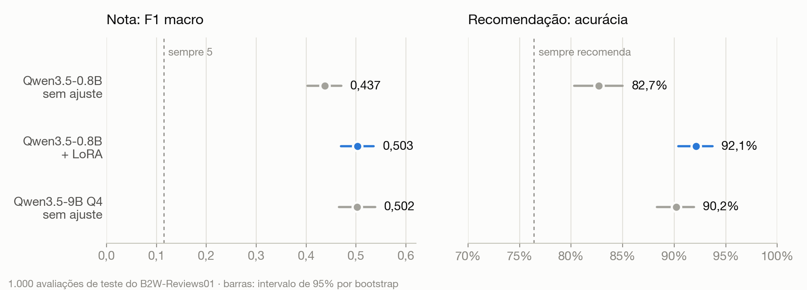
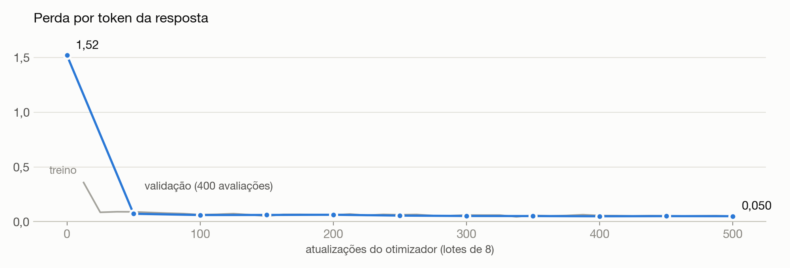

# Ajustei um modelo de 0,8B e ele empatou com um de 9B. Veja como medi

*Fine-tune com LoRA num Mac, em avaliações de clientes em português, e as três coisas que quase estragaram o resultado.*

Modelos pequenos são baratos de rodar, mas costumam perder para os grandes. Eu queria responder uma pergunta concreta: se eu ajustar um modelo de 0,8 bilhão de parâmetros para uma tarefa só, ele alcança um modelo 11 vezes maior que não foi ajustado?

A tarefa: ler uma avaliação de cliente em português e devolver um JSON com a nota que a pessoa deu ao produto (1 a 5) e se ela o recomendaria a um amigo.

```text
Título: Não recomendo
Avaliação: Chegou com a tela trincada e o suporte não responde.
→ {"nota": 1, "recomenda": false}
```

É o tipo de coisa que uma empresa com milhões de avaliações quer fazer em escala e gastando pouco. Comparei três modelos com o mesmo prompt: o Qwen3.5-0.8B sem ajuste, o mesmo modelo com um adaptador LoRA de 14 MB e o Qwen3.5-9B quantizado em 4 bits, sem ajuste.

Resposta curta: na nota, o 0,8B ajustado empatou com o 9B. Na recomendação, passou dele. E, no mesmo Mac, responde quase quatro vezes mais rápido.



A resposta longa é mais interessante, porque o caminho teve uma armadilha de medição, um treino que não cabia na memória e uma licença errada.

## Os dados: dividir por produto, não por avaliação

Usei o B2W-Reviews01, com 132 mil avaliações reais da Americanas, de 2018. Cada uma tem a nota em estrelas e a resposta à pergunta "você recomendaria este produto a um amigo?". Tirei as avaliações sem texto (3.275), as sem resposta de recomendação (18) e os textos repetidos (2.384).

A decisão que mais pesa no resultado é como separar treino e teste. O jeito óbvio é sortear avaliações. O problema é que um produto tem dezenas de avaliações parecidas: se umas caem no treino e outras no teste, o modelo é testado em produtos que já viu, e o número sai otimista. Por isso dividi pelo hash do `product_id`, e cada produto inteiro cai numa parte só. Os textos repetidos saíram antes da divisão pelo mesmo motivo: "Produto excelente, recomendo" aparece em muitos produtos diferentes.

De cada parte tirei uma amostra aleatória, sem balancear: 4.000 avaliações de treino, 400 de validação e 1.000 de teste. O teste tem a distribuição real das notas, com 40% de notas 5 e só 6% de notas 2.

## Medir antes de treinar

A acurácia engana nessa tarefa. Um "modelo" que responde sempre 5 acerta 40% das notas e parece razoável. A métrica principal foi o **F1 macro**, a média do F1 de cada uma das cinco notas, que dá o mesmo peso às notas raras. Nele, o chute de sempre responder 5 marca 0,115.

Também separei formato de conteúdo. Um JSON quebrado conta como formato inválido, mas os valores ainda são lidos por expressão regular. Assim, "errou o formato" e "errou a nota" aparecem como problemas diferentes.

E calculei intervalos de confiança. Com 1.000 exemplos e só 62 notas 2, o F1 macro varia alguns centésimos de uma amostra para outra. O bootstrap, com 1.000 reamostragens do teste, dá o intervalo de cada modelo. Para comparar dois modelos, porém, dois intervalos que se encostam não dizem nada. O que vale é o **bootstrap pareado**: reamostrar os mesmos exemplos para os dois modelos e olhar o intervalo da diferença, o que tira a variação que vem dos exemplos difíceis para todos.

Isso fez diferença logo na primeira comparação. Os intervalos do modelo base e do ajustado se encostam em 0,470, o que parece um empate. A diferença pareada, de +0,066 (intervalo de +0,024 a +0,109), mostra que o ganho é real.

A linha de base já sabia fazer a tarefa: o 0,8B sem ajuste marca 0,437 de F1 macro. Mas ele chuta 5 demais (170 das 224 notas 4 viraram 5) e quebra o formato em 35 respostas, com `"nota": 0`, `"recomenda": "true"` entre aspas ou `"nota": 10`.

## O treino que não cabia na memória

A primeira tentativa foi o padrão: LoRA de rank 16 em todas as 24 camadas, lotes de 8, com o [mlx-lm](https://github.com/ml-explore/mlx-lm) num Mac com M5 e 24 GB. Estourou a memória da GPU no primeiro passo. Com lotes de 4 e checkpoint de gradiente, rodou, mas a 0,13 lote por segundo e com 12 GB de pico. Para um modelo de 0,8B isso não fazia sentido, e as duas passadas que eu tinha planejado levariam mais de 4 horas.

A pista estava na arquitetura. O Qwen3.5 é híbrido: 18 das 24 camadas usam atenção linear (Gated DeltaNet), uma recorrência que atualiza um estado a cada token, em vez da atenção completa. Lendo o código do modelo no mlx-lm, achei esta linha:

```python
use_kernel=not self.training
```

Fora do treino, a recorrência roda num kernel Metal escrito à mão. Em treino, como o kernel não tem gradiente, o mlx-lm usa a implementação de referência: um laço em Python que processa um token por vez. Para o backward, o framework guarda o estado de cada passo, uma matriz de 16 × 128 × 128 em float32, ou 1 MB por token, por sequência e por camada. Pela conta, um lote de 4 avaliações de uns 150 tokens soma perto de 11 GB só de estados nas 18 camadas.

A saída veio de uma observação simples: o gradiente só precisa passar pelas camadas que têm LoRA. As camadas abaixo delas não têm nada treinável e só recebem os embeddings, que estão congelados. Então pus o LoRA só nas 8 camadas de cima e prendi as 16 de baixo em modo de avaliação, onde usam o kernel rápido:

```python
def congelar_em_avaliacao(camadas):
    def fixar(_, modulo):
        modulo._training = False
        modulo._set_training_mode = lambda modo: None

    for camada in camadas:
        camada.apply_to_modules(fixar)

congelar_em_avaliacao(modelo.layers[:-8])
```

O laço lento ficou restrito às 6 camadas de atenção linear que recebem LoRA. O treino passou para 0,37 lote por segundo, quase três vezes mais rápido. Fiz uma passada só pelos 4.000 exemplos: 500 atualizações de 8, com AdamW, taxa de 1e-4 com decaimento cosseno e perda só nos tokens da resposta. Levou 45 minutos, com pico de 17 GB.



Quase toda a queda acontece nas primeiras dezenas de atualizações, quando o modelo aprende o formato. Depois disso, a perda de validação desce devagar, de 0,072 para 0,050.

## Resultados

No teste, com 1.000 avaliações de produtos que o modelo nunca viu:

- **Formato:** o ajustado acerta 100% das vezes, contra 96,5% do base e 99,6% do 9B.
- **Nota (F1 macro):** 0,503 no ajustado, contra 0,437 do base e 0,502 do 9B. A diferença pareada para o 9B é de +0,001 (de −0,041 a +0,040): empate.
- **Recomendação (acurácia):** 92,1% no ajustado, contra 82,7% do base e 90,2% do 9B. A vantagem sobre o 9B é de 1,9 ponto (de +0,6 a +3,2), e o intervalo não chega a zero.
- **Velocidade:** uma avaliação por vez, no mesmo Mac, o ajustado responde em 0,26 s e o 9B em 1,02 s.

O 9B tem a maior acurácia exata na nota (63,9%, contra 61,2%), e vale entender por quê: ele também responde muito 5. Acerta 386 das 403 notas 5, mas só 44 das 224 notas 4. Como 40% do teste é nota 5, esse viés rende acurácia. O F1 macro pesa as cinco notas igualmente e não premia o viés, e por ele os dois empatam.

## O que piorou

A nota 2. O modelo base acertava 22 das 62; o ajustado acerta 8 e manda 41 delas para a nota 1. A nota 2 é só 6% do treino, e o adaptador aprendeu essa raridade. O próximo experimento é treinar com amostragem balanceada e ver quanto isso custa nas outras notas.

## Parte do teto está nos rótulos

Olhei um por um os 12 erros de 3 pontos ou mais do modelo ajustado. A maioria não é bem erro do modelo. São perguntas postadas no lugar da avaliação, como "Esse Hoverboard são de quantas polegadas?" com nota 5, ou textos que elogiam o produto e reclamam da entrega.

A recomendação dá uma ideia desse teto. Uma regra que conhece a nota real, "recomenda se a nota for 3 ou mais", acerta 95,4% do teste. O modelo, lendo só o texto, chega a 92,1%.

## Um detalhe de licença

O espelho do dataset no Hugging Face o marca como CC BY 4.0. O repositório original da B2W diz outra coisa: CC BY-NC-SA 4.0, que só permite uso não comercial e exige que derivados sigam os mesmos termos. Segui a licença original, que é a mais restritiva, para os dados e para o adaptador publicado. Antes de publicar qualquer coisa treinada com dados de terceiros, vale conferir a licença na fonte, e não no espelho.

## Limites

- As avaliações são de uma loja só, de janeiro a maio de 2018. O intervalo de confiança mede o ruído da amostra, não o quanto o resultado vale para outros sites.
- Foi um treino só, com uma semente e sem busca de hiperparâmetros. A variação entre treinos não está medida.
- O base e o 9B foram testados sem exemplos no prompt. Um prompt com alguns exemplos poderia melhorar os dois.
- A comparação de velocidade é entre conjuntos: o 0,8B roda no MLX em bf16, e o 9B, no llama.cpp com 4 bits.

## Código e modelo

O código, os dados divididos, os resultados de cada modelo e os testes estão em [github.com/Lucaddias/ptbr-review-classifier](https://github.com/Lucaddias/ptbr-review-classifier). O adaptador está no Hugging Face, em [oluca/qwen3.5-0.8b-ptbr-reviews-lora](https://huggingface.co/oluca/qwen3.5-0.8b-ptbr-reviews-lora), com um exemplo de uso. Dá para refazer tudo num Mac com Apple Silicon, do download do dataset à tabela final.
